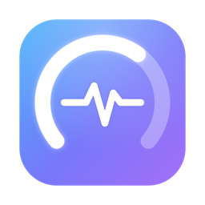
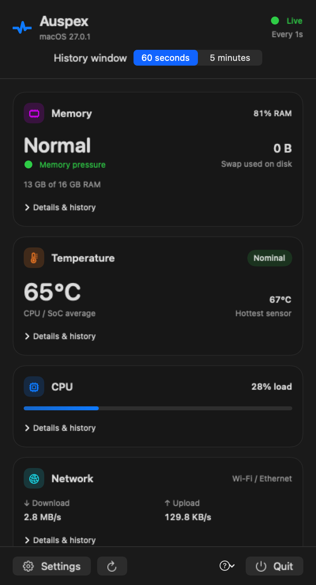
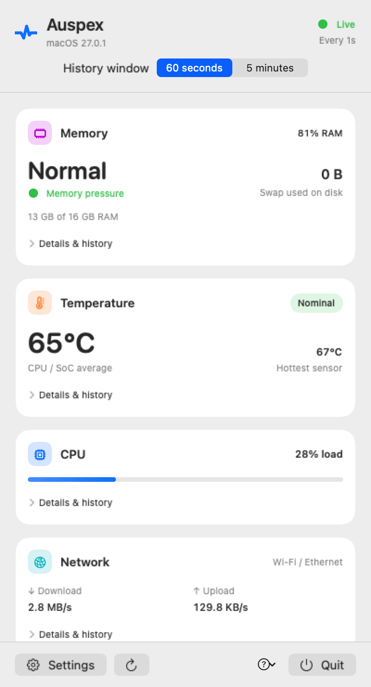

<div align="center">



# Auspex

**A lightweight, beautiful macOS menu bar monitor for your system's vital signs.**

Disk · RAM · CPU · Network · Battery · Temperatures — at a glance, with a readable native UI.


[](https://github.com/breadoncee/Auspex/releases/latest/download/Auspex.zip)

**[⬇ Download the latest release](https://github.com/breadoncee/Auspex/releases/latest/download/Auspex.zip)** · [All releases](https://github.com/breadoncee/Auspex/releases)

</div>

---

Auspex lives in your menu bar. Click the pulse icon for a live, readable panel of everything
your Mac is doing right now. It's native SwiftUI, uses only built-in macOS APIs (zero
third-party dependencies), and collects readings on a background queue with bounded refresh work.

> In ancient Rome, an *auspex* read the signs to divine the state of things. This one reads
> your Mac's.

## Screenshots




## Features

- **CPU** — overall load, expandable per-core bars, timestamped history, and a shortcut to Activity Monitor.
- **Memory** — pressure-first summary, RAM and disk-backed **Swap used**, with expandable app / wired / compressed details. Failed pressure queries stay unknown or visibly stale; swap is separate from RAM.
- **Storage** — writable local storage shown first, with read-only images and network mounts in a separate reference list. Unknown capacity stays unavailable; real zero available space stays zero. Reclaimable-capacity estimates are labeled available.
- **Network** — Wi-Fi/Ethernet throughput from 64-bit counters, with trend sparklines and observed traffic totals. VPN and peer-to-peer interfaces are excluded to avoid counting packets twice.
- **Battery** — charge, charging state, health %, and cycle count (laptops only).
- **Temperatures** — a prominent CPU/SoC average and hottest-sensor reading in °C, expandable individual sensors, and system thermal status.
- **Custom menu bar mark** with optional inline CPU %, RAM %, or temperature. Stale values show a dash rather than appear live.
- **Readable native UI** — compact cards with persistent ordering and visibility, expandable details, light/dark appearance, VoiceOver summaries, Reduce Motion and Reduce Transparency support.
- **Short history** — real 60-second or five-minute windows for CPU, network, temperature, pressure and swap. Gaps mark pauses; network charts share a scale. History stays in memory and does not enable background recording.
- **Honest freshness** — per-reading timestamps preserve dated last-good values after failures.
- **Check for Updates** — checks public GitHub releases only when requested, then opens the release page; no automatic installation or third-party updater.
- **Frugal** — one shared timer with no sampling backlog; only the selected menu bar metric updates while closed. Icon-only mode pauses polling, and sleep pauses all collection. Low Power Mode and elevated thermal pressure reduce optional update frequency.
- **Open at login** via `SMAppService`.

## Requirements

- **macOS 26 or later**, on Apple Silicon. Version 1.3.0 keeps the macOS 26 deployment target and was built with Xcode 27. Live checks were run on macOS 27.0.1; a separate macOS 26 hardware run remains desirable.
- **Apple Silicon** (arm64).
- To build: **Xcode 26+** and [XcodeGen](https://github.com/yonaskolb/XcodeGen) (`brew install xcodegen`), or **Command Line Tools with a macOS 26+ SDK** using `make local`.

## Install

### Option A — Download (no Xcode needed)

1. **[Download Auspex.zip](https://github.com/breadoncee/Auspex/releases/latest/download/Auspex.zip)** (always the newest release) and unzip it. _(Or pick a specific version from the [Releases](../../releases) page.)_
2. Move **Auspex.app** to your `/Applications` folder.
3. Because the app is open-source and **not signed with a paid Apple Developer ID**, macOS
   Gatekeeper will quarantine it on first launch. Clear it with one command:

   ```bash
   xattr -dr com.apple.quarantine /Applications/Auspex.app
   ```

   Then open it normally. _(Alternative: right-click the app → **Open** → **Open**; on recent
   macOS you may instead need **System Settings → Privacy & Security → Open Anyway**.)_

4. Look for the pulse icon in your menu bar. To keep it around, enable **Open at Login** in
   the app's Settings.

> Why the extra step? Notarizing apps for friction-free download requires a paid Apple
> Developer account. Building from source (Option B) avoids this entirely, since your Mac
> signs the app locally.

### Option B — Build from source (recommended)

```bash
git clone https://github.com/breadoncee/Auspex.git
cd Auspex
brew install xcodegen     # one-time, if you don't have it
make run                  # generates the project, builds, and launches
```

That's it. `make install` copies an optimized build to `/Applications`.

## Usage

- **Click** the menu bar pulse icon to open/close the panel.
- **Settings** (in the panel footer): refresh interval, which stat shows inline in the menu
  bar (CPU %, RAM %, temperature, or icon only), card visibility/order, appearance (**Follow macOS**, **Light**, or **Dark**), and **Open at Login**.
- **Refresh** all readings from the panel footer. CPU and network rates need the next sample after opening or waking.
- Open **Details & charts** within a card. **Chart time range** chooses how far back the charts show: **Last minute** or **Last 5 min**. Recording pauses while the panel is closed, so those periods appear as gaps.
- In Settings, reorder/hide cards or restore the defaults. Memory and temperature appear first by default.
- **Check for Updates** in Settings opens a newer stable release when available.
- If the menu item is hidden, reopen Auspex to open Settings, then check macOS **System Settings → Menu Bar → Allow in the Menu Bar**. A crowded menu bar can also hide items.
- **Quit** from the panel footer.

## Building & packaging

This project is generated from `project.yml` by XcodeGen, so the `.xcodeproj` is not checked
in — `make` regenerates it for you.

| Command | What it does |
|---|---|
| `make run` | Build (Debug) and launch with full Xcode |
| `make local` | Build `build/Local/Auspex.app` with Command Line Tools (macOS 26+ SDK) |
| `make verify` | Compile and run collector and lifecycle regression checks |
| `make build` | Build the Debug `.app` |
| `make release` | Build the optimized Release `.app` |
| `make dist` | Package `dist/Auspex-<version>.zip` for a GitHub Release |
| `make install` | Copy a Release build into `/Applications` |
| `make icon` | Regenerate the app icon + menu bar glyph |
| `make clean` | Remove build artifacts and the generated project |

Prefer Xcode? Run `xcodegen generate`, then `open Auspex.xcodeproj`.

### Cutting a release

```bash
make dist
```

Then create a new GitHub Release and upload `dist/Auspex-<version>.zip`. Bump the version in
`project.yml` (`MARKETING_VERSION`) and pass it through, e.g. `make dist VERSION=1.3.0`. See [signed distribution](docs/distribution.md) for the optional Developer ID/notarization flow; the default build remains ad-hoc signed.

## How it works

Everything is read with native macOS APIs — no dependencies:

| Metric | API |
|---|---|
| Disk | `FileManager.mountedVolumeURLs` + `URLResourceValues` |
| Memory | `host_statistics64` + pressure events / best-effort pressure sysctl + `vm.swapusage` |
| CPU | `host_processor_info` (tick diffing, per core) |
| Network | `getifaddrs` + `sysctl` / `ifmibdata` (64-bit per-interface counter diffing) |
| Battery | IOKit power sources + `AppleSmartBattery` |
| Temperatures | private `IOHIDEventSystemClient` (best-effort) + `ProcessInfo.thermalState` |

A single `@Observable` `SystemMonitor` owns one timer and orchestrates per-metric collectors
on a background queue, publishing snapshots to the SwiftUI views.

## Project structure

```
project.yml                  XcodeGen spec (target, signing, IOKit linkage, app icon)
Makefile                     build / package / install tasks
Sources/
  AuspexApp.swift            @main — MenuBarExtra(.window) + Settings
  Assets.xcassets/           app icon + menu bar glyph
  Bridging/                  private IOHID temperature declarations
  Model/                     value types, thresholds, formatters, SystemMonitor
  Collectors/                one collector per metric (native APIs)
  Views/                     panel, cards, gauges, sparklines, settings, logo
  Services/                  launch-at-login (SMAppService)
Tools/                       icon/glyph generators + a CLI verification harness
```

## Notes & caveats

- **Unsigned distribution.** The prebuilt download is ad-hoc signed, so first-launch needs
  the Gatekeeper step above. Building from source avoids it.
- **Temperatures are best-effort.** Apple Silicon has no public temperature API, so Auspex
  uses a private IOKit API (the same approach as similar tools). It can break on future macOS
  releases and rules out Mac App Store distribution. Private functions are resolved at
  runtime so missing symbols do not prevent launch; the app falls back to the public
  thermal state. Sensor rows use unique registry IDs even when names repeat. Every other
  metric uses stable, public APIs.
- **Not sandboxed** — it's a personal/local utility, not an App Store app.

## Changelog

See [CHANGELOG.md](CHANGELOG.md) for the version history.

## Verification

```bash
make verify
# Run outside restrictive tool sandboxes to require real mounted volumes:
Tools/verify.sh --require-volumes --require-temperatures --require-swap
# Full Xcode is required for the SwiftUI render harness:
DEVELOPER_DIR=/Applications/Xcode.app/Contents/Developer Tools/verify-visuals.sh
Tools/benchmark.sh --mode cpu --duration 60
make local
open build/Local/Auspex.app
```

The regression harness also checks unknown pressure, read-only/unknown disk capacity, history retention/gaps, preference migration and update metadata/network failures. The visual harness renders deterministic light/dark fixtures; it does not replace a keyboard/VoiceOver audit.

The regression harness checks memory accounting, 64-bit network counters, interface
changes, counter resets, live swap usage and unavailable-query handling, unique sensor identities, CPU/battery/storage bounds, and
monitor refresh bursts and sleep/wake transitions. It also renders the menu bar logo
in light and dark appearances with loose PNGs and missing resources. It uses an isolated preferences
suite. Storage and temperature APIs may return no data inside a development sandbox.

Memory is a resident estimate (anonymous non-purgeable pages + wired + compressed),
not an exact reproduction of Activity Monitor's private accounting. Network totals
count traffic observed while collecting; they exclude periods when the panel is
closed and rates are rebaselined on opening or waking.

## Contributing

Issues and PRs welcome. Run `make run` (Xcode) or `make local` (Command Line Tools) to build locally; `Tools/main.swift` is a CLI harness
that prints a snapshot for cross-checking values against `df`, `top`, `pmset`, etc.

## License

[MIT](LICENSE) © breadoncee
